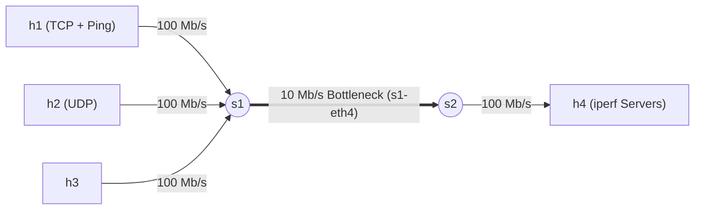
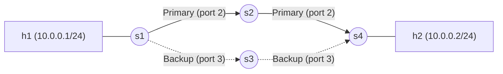

# ENCS5321 — Mininet Topologies, Congestion Management & SDN Recovery


Laboratory implementations for **Advanced Computer Networks (ENCS5321)** at **Birzeit University**, exploring Mininet topology emulation, bottleneck congestion & active queue management (FIFO vs. RED), and OpenFlow 1.3 controller-based link failure recovery using the **Ryu SDN controller**.

---

## Repository Structure

```text
ENCS5321-Mininet-SDN-Lab/
├── .gitignore
├── LICENSE
├── README.md
├── task1_topologies/
│   └── mytopo0.py                # Custom Python Topo subclass with static IP & MAC addressing
├── task2_congestion_aqm/
│   ├── task2.py                  # 4-host, 2-switch topology with 10 Mb/s HTB bottleneck link
│   └── commands.md               # Reproducible tc (pfifo/red), iperf, and ping CLI commands
└── task3_sdn_recovery/
    ├── task3_recovery.py         # 4-switch redundant diamond OpenFlow 1.3 topology
    └── task3_controller.py       # Ryu OpenFlow 1.3 controller for EventOFPPortStatus failover
```

---

## Prerequisites & Environment Setup

All experiments were verified on **Ubuntu under Windows Subsystem for Linux (WSL)** with the following packages:

```bash
sudo apt update
sudo apt install -y mininet openvswitch-switch iperf iproute2 python3-pip
pip3 install ryu
sudo service openvswitch-switch start
```

Before starting any new experiment after an interrupted run, clean up leftover Mininet interfaces and namespaces:

```bash
sudo mn -c
```

---

## Task 1 — Mininet Installation and Basic Network Topologies

Verifies Mininet 2.3.0 operation, builds standard topologies (`single`, `linear`, `tree`) from the CLI, implements a custom Python topology (`task1_topologies/mytopo0.py`), and validates connectivity using `net`, `dump`, `ping`, and `pingall`.

### CLI Topologies

```bash
# 1. Verify installation and self-test
mn --version
sudo mn --test pingall

# 2. Built-in topologies (inside mininet> CLI run: net, dump, pingall, exit)
sudo mn --topo single,3
sudo mn --topo linear,4
sudo mn --topo tree,depth=2,fanout=2
```

### Custom Python Topology (`mytopo0.py`)

`MyTopo` connects `h1` (`192.168.1.100`, `00:00:00:00:00:11`) and `h2` (`192.168.1.101`, `00:00:00:00:00:22`) across two switches (`s3 <-> s4`):

```bash
sudo mn --custom task1_topologies/mytopo0.py --topo mytopo --link tc
```

Inside the `mininet>` prompt:

```text
mininet> net
mininet> dump
mininet> h1 ping -c 4 h2
mininet> pingall
```

### Task 1 Reachability Summary

| Topology / Command | Hosts | Switches | Links | Observed `pingall` Result |
|---|---:|---:|---:|---|
| `sudo mn --test pingall` (minimal) | 2 (`h1–h2`) | 1 (`s1`) | 2 | `0% dropped (2/2 received)` |
| `sudo mn --topo single,3` | 3 (`h1–h3`) | 1 (`s1`) | 3 | `0% dropped (6/6 received)` |
| `sudo mn --topo linear,4` | 4 (`h1–h4`) | 4 (`s1–s4`) | 7 | `0% dropped (12/12 received)` |
| `sudo mn --topo tree,depth=2,fanout=2` | 4 (`h1–h4`) | 3 (`s1–s3`) | 6 | `0% dropped (12/12 received)` |
| `mytopo0.py` (`--topo mytopo`) | 2 (`h1–h2`) | 2 (`s3–s4`) | 3 | `0% dropped (2/2 received)` |

---

## Task 2 — Network Congestion and Queue Management (FIFO vs. RED)

Evaluates simultaneous TCP (`h1 -> h4`), UDP (`h2 -> h4`), and ICMP (`h1 -> h4`) traffic contending across a shared **10 Mb/s** bottleneck link (`s1-eth4` ↔ `s2-eth2`) under **Drop-Tail FIFO (`pfifo`)** and **Random Early Detection (`red`)**.

### Topology (`task2.py`)



### Running the Experiment

```bash
sudo python3 task2_congestion_aqm/task2.py
```

See [`task2_congestion_aqm/commands.md`](task2_congestion_aqm/commands.md) for the complete sequence of `tc`, `iperf`, and `ping` commands executed inside the Mininet CLI.

### Observed Results (FIFO vs. RED)

| Metric | FIFO (`pfifo limit 100p`) | RED (`min 30KB, max 90KB, P=0.02`) |
|---|---:|---:|
| TCP throughput (`h1 -> h4`) | `6.16 Mb/s` | `1.93 Mb/s` |
| UDP sender rate (requested `-b 15M`) | `3.84 Mb/s` (`9,805 pkts`) | `15.7 Mb/s` (`40,128 pkts`) |
| UDP receiver throughput (`h4`) | `3.83 Mb/s` | `9.45 Mb/s` |
| UDP packet loss | `0%` (`0 / 9,804`) | `40%` (`16,036 / 40,127`) |
| ICMP ping packet loss (`150` probes) | `0%` (`150 / 150` received) | `58%` (`63 / 150` received) |
| ICMP ping average RTT (`min / avg / max`) | `179.424 ms` (`0.046 / 179.424 / 275.983`) | `64.344 ms` (`0.140 / 64.344 / 76.118`) |
| Active child queue drops | `0` | `16,202` (`16,198 early + 4 pdrop`) |

> **Experimental Notes:**
> - **Cumulative HTB root counter:** In the later FIFO `tc -s qdisc` output, root `htb 5:` retains the cumulative `dropped 16202` count from the preceding RED run, while the active child `pfifo 30:` discipline itself recorded `0` drops.
> - **Interpretation scope:** Both runs requested `15 Mb/s` UDP (`-b 15M`), yet the measured UDP sender rates differed (`3.84 Mb/s` under FIFO vs. `15.7 Mb/s` under RED). This table compares the two observed runs; because the actual offered UDP load differed, the results do not isolate the effect of the queue discipline alone, nor do they establish the cause of the lower UDP sending rate in the FIFO run.

---

## Task 3 — SDN Link Failure Detection and Automatic Recovery

Constructs a four-switch redundant diamond topology (`task3_sdn_recovery/task3_recovery.py`) controlled over **OpenFlow 1.3** by a **Ryu** controller (`task3_sdn_recovery/task3_controller.py`). Upon detecting a link-down `EventOFPPortStatus` on primary trunk `s1-eth2` (`dpid=1, port=2`), `RecoveryController` flushes stale flows (`OFPFC_DELETE`) and installs bidirectional rules over the backup route through `s3`.

### Diamond Topology



### Running the Experiment (Two Terminals)

**Terminal 1 — Start the Ryu OpenFlow 1.3 Controller:**

```bash
ryu-manager task3_sdn_recovery/task3_controller.py
```

**Terminal 2 — Start the Mininet Diamond Topology:**

```bash
sudo python3 task3_sdn_recovery/task3_recovery.py
```

**Simulate Link Failure & Verify Failover (inside `mininet>` CLI):**

```text
mininet> sh ovs-ofctl -O OpenFlow13 dump-flows s1
mininet> h1 ping -D -O -i 0.2 -c 150 h2 > /tmp/task3_ping.txt 2>&1 &
mininet> sh sleep 3
mininet> link s1 s2 down
mininet> h1 ping -c 4 h2
mininet> sh ovs-ofctl -O OpenFlow13 dump-flows s1
mininet> sh ovs-ofctl -O OpenFlow13 dump-flows s3
mininet> h1 tail -n 12 /tmp/task3_ping.txt
```

### Recovery Measurements

| Parameter / Measurement | Observed Result |
|---|---|
| Primary forwarding route | `h1 -> s1 (eth1->eth2) -> s2 -> s4 (eth2->eth1) -> h2` |
| Backup forwarding route | `h1 -> s1 (eth1->eth3) -> s3 -> s4 (eth3->eth1) -> h2` |
| Post-failure verification ping (`h1 ping -c 4 h2`) | `4/4` received (`0%` loss), avg RTT `0.261 ms` |
| Continuous background ping (`0.2 s` probe spacing) | `150/150` received (`0%` loss), avg/max RTT `0.106 / 0.830 ms` |
| Controller failure-handler processing time | `0.000790 seconds` (`0.790 ms`) |
| Full end-to-end recovery interval | Not directly measured |

> **Scope of `0.790 ms`:** The controller measures `time.monotonic()` strictly from entering the `EventOFPPortStatus` failure handler to completing `OFPFlowMod` dispatch. It does not measure OVS link-down detection latency, OpenFlow TCP transport, or switch hardware/datapath update delay.

---

## Author

**Motaz Altell**  
Department of Electrical and Computer Engineering, Birzeit University  
Course: *ENCS5321 — Advanced Computer Networks*
